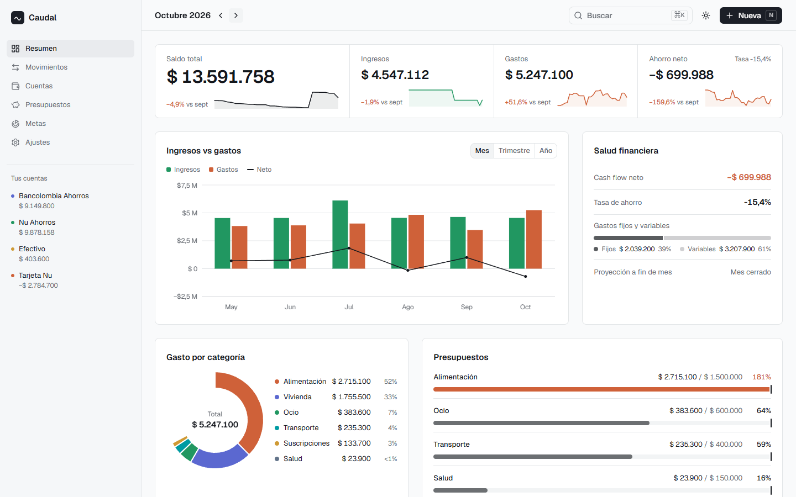
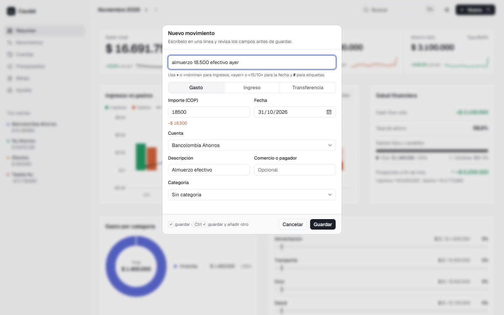
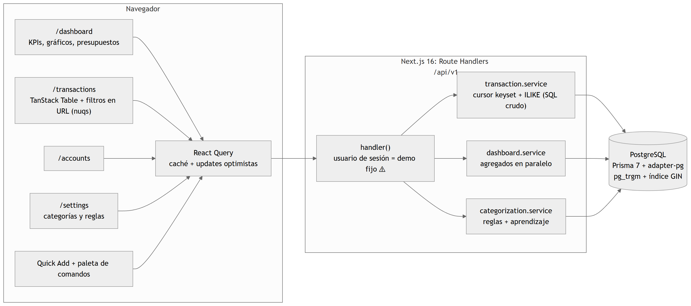

# Caudal

**[English](#english) · [Español](#español)**



**Stack:** Next.js 16 · TypeScript · PostgreSQL (`pg_trgm`) · Prisma 7 · TanStack Query & Table · React Hook Form + Zod · shadcn/ui · Recharts · Vitest

---

## English

Personal finance with free-text quick entry. Type a sentence like `Netflix 44.900 tarjeta nu` and the app infers the amount, the account and the category, and learns from your corrections.

> **Single-user demo:** there is no login yet; all data belongs to a demo user.

### How it was built

I built this project with **Claude Code**, an AI coding agent. I defined what to build and gave the instructions. The agent wrote the code and the tests from a 17-story PRD in about **4 hours**. Every commit carries the agent's co-author trailer, and the PRD and the run log are in [`claude-loop/archive/`](claude-loop/archive/). I reviewed the generated code and tested each feature by hand. **It never had real users.**

### What it does

- **Quick entry** (`N`): type `almuerzo 18.500 efectivo ayer #trabajo` and review the parsed fields before saving.
- **Automatic categorization** by rules that learn: after you correct the same merchant twice, a new rule is created.
- **Transactions**: table with filters in the URL, typo-tolerant search, cursor pagination and delete with undo.
- **Dashboard**: balance, income vs. expenses, end-of-month projection, spending by category and budgets.



### Architecture



- Server Components prefetch the data and React Query keeps it cached on the client.
- Writes go through Route Handlers under `/api/v1/*` with optimistic updates.
- Services always filter by user.
- **Cursor pagination in SQL** on `(date, id)` instead of `OFFSET`, with search backed by a `pg_trgm` GIN index. The cost: hand-written SQL loses Prisma's typing and has no tests against a real database.
- **Money as `Decimal(19,4)`.** Only the dashboard converts to numbers to display rounded aggregates.

Full architecture: [`docs/ARQUITECTURA.md`](docs/ARQUITECTURA.md) (Spanish).

### Run it locally

Requires Node.js 22+ and a local PostgreSQL (tested with 18). The database user must be able to create the `pg_trgm` extension; the `postgres` superuser can. Tested from a clean clone on Windows on 2026-11-01.

```bash
git clone https://github.com/nicho1607/caudal.git
cd caudal

psql -U postgres -c "CREATE DATABASE caudal"

cp .env.example .env   # DATABASE_URL and DIRECT_URL → postgresql://postgres:<password>@localhost:5432/caudal
npm ci
npx prisma migrate deploy   # also creates pg_trgm and the GIN index
npm run db:seed             # 6 months of sample data ending today
npm run dev                 # http://localhost:3000/dashboard
```

At the start of a month the current month has few transactions; use "previous month" to see a full one.

| Command | What it does |
|---|---|
| `npm run typecheck` | `tsc --noEmit` |
| `npm test` | Vitest: logic, hooks, components and services with a mocked DB. **250 / 250 in 12.2 s** (local, 2026-11-01) |
| `npm run build` / `npm start` | Production build and server |

Keyboard: `N` new transaction · `Ctrl/⌘ + K` command palette · `Ctrl + Enter` save and add another.

### Known limitations

- No authentication: one demo user.
- Budgets and goals don't have a working screen yet; recurring transactions and multi-currency are modeled but not implemented.
- No integration tests against Postgres for the hand-written SQL, and no CI.
- Lighthouse on the dashboard: Performance 99 on desktop but **76 on mobile**.

---

## Español

Finanzas personales con alta rápida en texto libre. Escribes una frase como `Netflix 44.900 tarjeta nu` y la app deduce el importe, la cuenta y la categoría, y aprende de tus correcciones.

> **Demo de un solo usuario:** todavía no tiene login; todos los datos son de un usuario demo.

### Cómo lo construí

Construí este proyecto con **Claude Code**, un agente de programación. Yo definí qué construir y le di las instrucciones. El agente escribió el código y los tests a partir de un PRD de 17 historias, en unas **4 horas**. Cada commit lleva su firma de coautor, y el PRD y el registro de la ejecución están en [`claude-loop/archive/`](claude-loop/archive/). Yo revisé el código generado y probé cada funcionalidad a mano. **No tuvo usuarios reales.**

### Qué hace

- **Alta rápida** (`N`): escribe `almuerzo 18.500 efectivo ayer #trabajo` y revisa los campos antes de guardar.
- **Categorización automática** con reglas que aprenden: tras dos correcciones del mismo comercio, se crea una regla nueva.
- **Movimientos**: tabla con filtros en la URL, búsqueda tolerante a errores de escritura, paginación por cursor y borrado con "Deshacer".
- **Dashboard**: saldo, ingresos vs. gastos, proyección a fin de mes, gasto por categoría y presupuestos.

### Arquitectura

- Los Server Components precargan los datos y React Query los mantiene en caché en el cliente.
- Las escrituras van por Route Handlers `/api/v1/*` con actualizaciones optimistas.
- Los servicios siempre filtran por usuario.
- **Paginación por cursor en SQL** sobre `(fecha, id)` en vez de `OFFSET`, con búsqueda apoyada en un índice GIN de `pg_trgm`. El costo: el SQL a mano pierde el tipado de Prisma y no tiene tests contra una base real.
- **Dinero en `Decimal(19,4)`.** Solo el dashboard lo convierte a número para mostrar agregados redondeados.

### Correrlo en local

Requiere Node.js 22+ y PostgreSQL local (probado con la 18); el usuario debe poder crear la extensión `pg_trgm`. Los comandos son los de la sección en inglés. `npm test` corre 250 / 250 tests en 12,2 s (local, 2026-11-01).

### Limitaciones conocidas

- Sin autenticación: un único usuario demo.
- Presupuestos y metas todavía no tienen pantalla funcional; recurrentes y multimoneda están modelados pero no implementados.
- Sin tests de integración contra Postgres para el SQL a mano y sin CI.
- Lighthouse del dashboard: Rendimiento 99 en escritorio pero **76 en móvil**.
